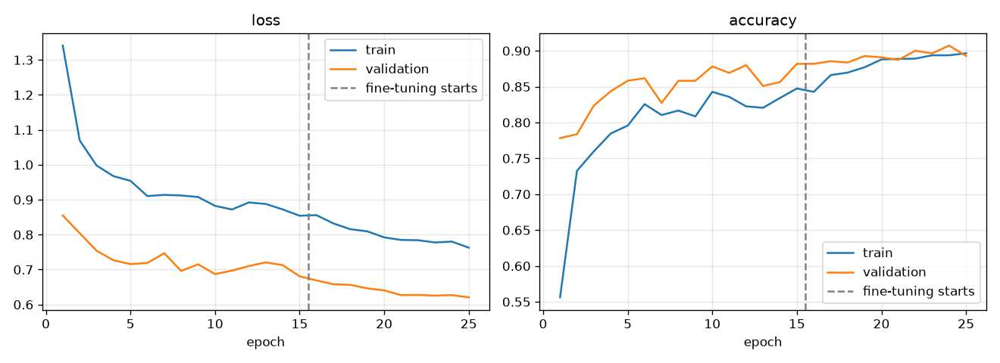
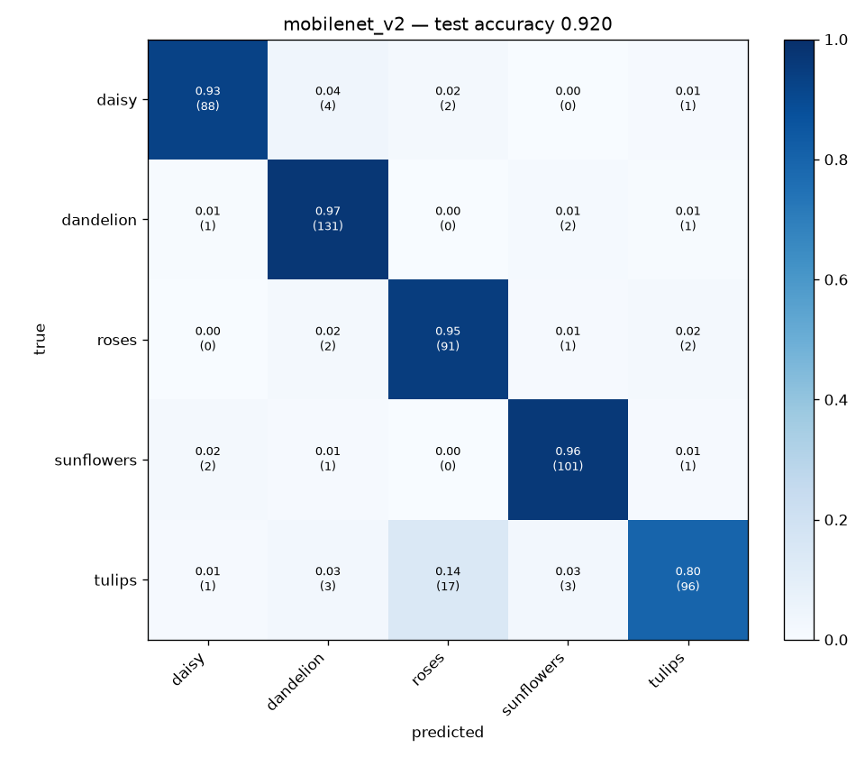
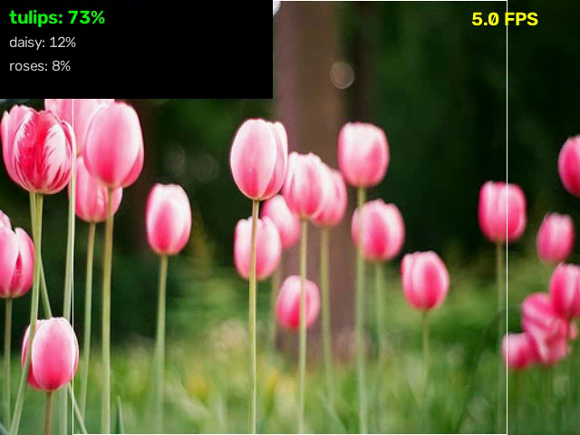

# Image Classification with CNNs

**TensorFlow · Keras · OpenCV · scikit-learn · TensorFlow Lite**

Multi-class image classification on a small dataset (the 5-class TensorFlow *flower photos*
set, 3,670 images), comparing a **CNN trained from scratch** with **transfer learning**
from ImageNet (**MobileNetV2** and **ResNet50V2**). The best model is exported to
**TensorFlow Lite** and served by a lightweight **OpenCV inference script** that runs on
single images, folders, or a live webcam / video stream in real time.

- **From-scratch CNN**: 4-stage VGG-style network (`[Conv-BN-ReLU]×2 → MaxPool → SpatialDropout`), global-average-pooling head, L2 weight decay.
- **Transfer learning, two phases**: (1) frozen ImageNet backbone + new head at lr 1e-3, then (2) unfreeze the top N backbone layers and fine-tune at lr 1e-5. BatchNorm layers stay frozen and in inference mode, so the small dataset cannot corrupt the ImageNet statistics.
- **Generalisation toolkit for limited data**: on-the-fly augmentation (flip, rotation, zoom, translation, contrast), **MixUp**, **label smoothing**, dropout / spatial dropout, L2, inverse-frequency **class weights**, `ReduceLROnPlateau`, and **early stopping** with best-checkpoint restore on validation accuracy.
- **Reproducible evaluation**: frozen, stratified 70/15/15 train/val/test splits shared by every model. Reports include accuracy, top-3 accuracy, macro precision/recall/F1, per-class reports, confusion matrices, parameter count, model size and CPU latency.
- **Deployment**: TFLite export (dynamic-range int8 or float16 quantisation), plus a `Predictor` class with an OpenCV preprocessing path that matches training. TFLite inference needs only NumPy, OpenCV and the `ai-edge-litert` runtime, not TensorFlow. CLIs cover batch prediction and real-time webcam/video classification with temporal smoothing and an FPS overlay.

## Results

Held-out test split: 551 images, 5 classes. Never used for training or model selection.

| Model | Params | Size | Test accuracy | Top-3 | Macro F1 | CPU latency |
|---|---:|---:|---:|---:|---:|---:|
| **MobileNetV2, transfer + fine-tuning** | 2.26M | 23.0 MB | **92.0%** | 99.5% | **0.919** | 304 ms |
| MobileNetV2, **TFLite** (dynamic-range int8) | 2.26M | **2.5 MB** | 91.7% | — | 0.916 | **133 ms** |
| Custom CNN, from scratch* | 1.18M | 14.2 MB | 66.1% | 92.6% | 0.652 | 90 ms |

- **Transfer learning is worth +26 points of accuracy** over the from-scratch CNN on this small dataset. Fine-tuning the top 40 MobileNetV2 layers raised validation accuracy from 88.2% (frozen backbone) to 90.7%.
- **TFLite quantisation makes the model 9× smaller and about 2.3× faster on CPU** for −0.4 points of accuracy. Per-class F1 for MobileNetV2: daisy 0.94, dandelion 0.95, roses 0.88, sunflowers 0.95, tulips 0.87. Roses and tulips are the classes it confuses most.
- Latency is the median single-image time on a 4-core Intel i5-6300U laptop CPU (no GPU), measured with OpenCV preprocessing plus the forward pass.

\* *The custom CNN run was stopped after 16 of its 40 planned epochs (about 5 min per epoch on CPU) and is reported at its best checkpoint (epoch 12). Its validation accuracy was still rising, so the full schedule would close part of the gap. ResNet50V2 is implemented and tested but was not trained for this report because of the CPU budget.*

| Training curves (MobileNetV2; dashed line = fine-tuning starts) | Confusion matrix (MobileNetV2, test) |
|---|---|
|  |  |

Real-time demo frame (`scripts/realtime.py` with the TFLite model, showing the smoothed top-3 and the center-crop guide):



## Project layout

```
cnnclf/config.py        paths + per-architecture defaults (image size, epochs, LRs, fine-tuning depth)
cnnclf/data.py          dataset download, frozen stratified splits, cached tf.data pipelines, class weights
cnnclf/augment.py       Keras augmentation layers + MixUp
cnnclf/models.py        custom CNN, MobileNetV2 / ResNet50V2 transfer models, selective unfreezing
cnnclf/train.py         two-phase training with callbacks; writes artifacts/<model>/
cnnclf/evaluate.py      test-set metrics, confusion matrices, latency, reports/comparison.md
cnnclf/export.py        Keras -> TFLite conversion with optional quantisation
cnnclf/predictor.py     lightweight inference wrapper (Keras or TFLite backend, OpenCV preprocessing)
scripts/predict.py      CLI: classify files / folders (table or JSON output)
scripts/realtime.py     CLI: real-time webcam / video classification with OpenCV
tests/                  unit + end-to-end tests on a synthetic dataset (no downloads needed)
data/splits/            frozen train / val / test CSVs + meta.json
reports/                generated metrics JSON, confusion matrices, comparison.md
```

## Quick start

```bash
pip install -r requirements.txt
```

1. Download the dataset (~220 MB) and write the frozen splits. To use your own data instead, pass `--source path/to/images` with a `<root>/<class_name>/*.jpg` layout.

```bash
python -m cnnclf.data
```

2. Train. Every hyperparameter is a CLI flag; run `python -m cnnclf.train -h` to see them.

```bash
python -m cnnclf.train --model mobilenet_v2
```

```bash
python -m cnnclf.train --model custom_cnn
```

```bash
python -m cnnclf.train --model resnet50_v2
```

3. Export to TFLite and evaluate every trained model on the test split:

```bash
python -m cnnclf.export --model mobilenet_v2 --quantize dynamic
```

```bash
python -m cnnclf.evaluate
```

4. Run inference. The trained TFLite model ships in `artifacts/mobilenet_v2/`, so this step works right after cloning:

```bash
python scripts/predict.py path/to/photo.jpg --model artifacts/mobilenet_v2/model.tflite
```

```bash
python scripts/realtime.py --model artifacts/mobilenet_v2/model.tflite
```

`realtime.py` also accepts a video file through `--source clip.mp4`. Add `--output annotated.mp4 --no-display` to run it headless.

5. Tests. They run on a generated shapes dataset, so nothing is downloaded.

```bash
python -m pytest -q
```

## Design notes

- **Augmentation lives in the input pipeline, not in the model.** The saved model then has no random layers, exports cleanly to TFLite, and needs no `training` flag at inference. Decoded images are cached as `uint8` (4× smaller than float32), and augmentation is re-sampled every epoch after the cache.
- **Models own their input scaling.** Every model takes raw RGB in `[0, 255]` and includes a `Rescaling` layer (`/255` for the custom CNN, `[-1, 1]` for MobileNetV2 and ResNet50V2). Training, evaluation, `Predictor` and the TFLite model therefore all feed images the same way, which rules out preprocessing skew.
- **The checkpoint is selected across both phases.** The phase-2 `ModelCheckpoint` is seeded with the phase-1 best validation accuracy, so fine-tuning can only replace the saved model if it actually improves on it.
- **Deployment parity is tested.** A test asserts that the TFLite model and the Keras model give the same probabilities (atol 1e-4). `evaluate.py` also scores the TFLite model through the OpenCV path and reports how often it agrees with the Keras model.
